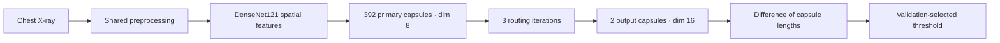

# NIR · DenseNet121 + Capsules

[](https://github.com/nico1008/NIR/actions/workflows/ci.yml)


A reproducible research implementation for **NORMAL / PNEUMONIA** classification
of chest X-rays. One architecture, one fixed training protocol, one held-out test
evaluation. The package combines a chest X-ray pretrained DenseNet121 backbone
with dynamic routing between capsules.

This repository contains source code, tests and software documentation. Images,
trained weights, generated experiment artifacts and academic reports stay local.

## Quick start

Use Python 3.12. Create and activate a virtual environment, then install the package:

```bash
git clone https://github.com/nico1008/NIR.git
cd NIR
python -m venv .venv
```

| Shell | Activate the environment |
| --- | --- |
| PowerShell | `.\.venv\Scripts\Activate.ps1` |
| bash / zsh | `source .venv/bin/activate` |

```bash
python -m pip install --upgrade pip
python -m pip install -e .
nir --help
```

For an NVIDIA GPU, install the matching PyTorch and torchvision wheels **before**
installing this package. Choose the wheel index for your driver using the
[official PyTorch installer](https://pytorch.org/get-started/locally/).
The original experiment used CUDA 12.8:

```bash
python -m pip install torch torchvision --index-url https://download.pytorch.org/whl/cu128
python -m pip install -e .
```

`requirements/experiment-cu128.txt` records the exact original Windows / Python
3.12 environment. It is an environment snapshot, separate from the compatible
package dependency ranges. To recreate that environment:

```bash
python -m pip install -r requirements/experiment-cu128.txt --extra-index-url https://download.pytorch.org/whl/cu128
python -m pip install -e . --no-deps
```

## Run an experiment

Supply your own labeled images. Class folders may sit below other directories;
the immediate parent of each image must be `NORMAL` or `PNEUMONIA`.
Supported extensions are `.jpg`, `.jpeg` and `.png`.

```text
data/
├── train/
│   ├── NORMAL/       # e.g. IM-0001-0001.jpeg
│   └── PNEUMONIA/    # e.g. person1_bacteria_1.jpeg
└── test/
    ├── NORMAL/
    └── PNEUMONIA/
```

The audit pools the supplied images and creates its own fixed group split;
existing `train` / `test` folder names do not determine the experimental split.
Files must follow the grouping patterns shown above. Unrecognized identifiers,
unreadable images and conflicting duplicate labels cause an explicit failure.

```bash
nir audit --data data --out runs/default
nir train --out runs/default
nir evaluate --out runs/default
nir predict --out runs/default --folder images
```

`python -m nir` accepts the same commands. Paths are relative to the current
working directory. `--workers 0` disables DataLoader subprocesses for debugging;
the default is four workers. Training downloads TorchXRayVision's pretrained
weights on first use. Tests and checkpoint restoration do not download weights.

The program refuses to overwrite an existing trained experiment or repeat a
completed test evaluation. Use a different `--out` directory for an intentionally
new experiment. Prediction writes `folder_predictions.csv` in the selected run.

## Architecture



| Component | Fixed choice |
| --- | --- |
| Backbone | TorchXRayVision `densenet121-res224-all` |
| Input | One channel, 224 × 224, normalized to [−1024, 1024] |
| Spatial features | 1024 × 7 × 7 |
| Primary capsules | Eight capsules of dimension eight per spatial position |
| Vote transforms | Separate trainable transform for each input / output capsule pair |
| Output | NORMAL and PNEUMONIA capsules, dimension 16 |
| Routing | Three iterations |

The same preprocessing function serves training, evaluation and prediction:
RGB channels are averaged after normalization, then centrally cropped to a square
and resized. No additional image augmentation is applied. Capsule lengths are
class scores; they are **not calibrated disease probabilities**.

## Experimental protocol

1. Hash decoded grayscale pixels and dimensions; exclude exact duplicates without
   deleting source files. Reject identical images with conflicting labels.
2. Infer group proxies from filenames. Keep each group in one split; group
   `person` numbers across bacteria / virus. Use 20 stratified group folds with
   seed 42: 14 training, three validation, three test.
3. Train the capsule head for three epochs. Then fine-tune DenseNet's final block
   and final normalization layer. Frozen BatchNorm statistics remain unchanged.
4. Use class-weighted margin loss, AdamW, batch size 32 and mixed precision on
   CUDA. Learning rates: 0.001 during head warm-up; then 0.0001 for capsules and
   0.00001 for the backbone. Stop after five epochs without validation AUC
   improvement, with a maximum of 20 epochs.
5. Choose the checkpoint by validation ROC-AUC and the decision threshold by
   Youden's index on that same validation split. Evaluate the held-out test set
   once after both selections are fixed.

The fixed protocol lives in [`src/nir/config.py`](src/nir/config.py).
Random seeds and deterministic cuDNN settings support repeatability within a
matching environment; results may differ across hardware and library versions.

## Local artifacts

| File | Purpose |
| --- | --- |
| `manifest.csv` | Paths, labels, group proxies, pixel hashes and fixed split |
| `audit.json`, `duplicates.json` | Counts, grouping limitations and excluded copies |
| `config.json`, `history.json` | Runtime versions, settings and epoch history |
| `best.pt` | Model state, selected epoch, configuration and manifest hash |
| `threshold.json` | Validation-selected threshold and checkpoint epoch |
| `val_predictions.csv`, `test_predictions.csv` | Class scores, decisions and error flags |
| `test_metrics.json` | ROC-AUC, average precision, sensitivity, specificity, F1 and accuracy |
| `folder_predictions.csv` | Predictions for an input folder |

The confusion matrix uses true classes as rows and predicted classes as columns,
ordered NORMAL then PNEUMONIA. PR-AUC is reported as **average precision**.
The manifest hash and checkpoint epoch are checked when restoring a model.
Existing `practice3_solution/results` checkpoints are compatible with this
package; pass that directory through `--out` without moving or changing its files.
Absolute image paths in a manifest must remain valid when using an existing run.

## Development

```bash
python -m pip install -e '.[dev]'
ruff check .
ruff format --check .
pytest
python -m build
```

Tests cover capsule shapes and gradients, the frozen backbone boundary,
deduplication, group isolation, preprocessing, CSV contracts, checkpoint /
threshold consistency, overwrite guards and CLI validation. CI runs lint checks
and CPU tests on Linux and Windows. It also builds the distributable package.
No dataset, network download or GPU is required for tests.

```text
.github/workflows/ci.yml          Automated quality and CPU checks
requirements/experiment-cu128.txt Exact original environment snapshot
src/nir/
├── cli.py                       Command-line interface
├── config.py                    Fixed experimental protocol
├── data.py                      Audit, splitting, preprocessing and loading
├── model.py                     DenseNet, capsules and margin loss
└── engine.py                    Training, selection, evaluation and inference
tests/                           Behavioral and contract tests
```

The earlier notebook is retained in Git history. The Python package is the
maintained implementation.

## Research boundaries

Filename groups are proxies, not verified patient identities. Local data
provenance and overlap with pretraining datasets are not established by this
implementation. Central cropping can remove peripheral image regions. A local
held-out result does not establish performance across institutions or age groups.

The code implements the chosen research architecture. It does not establish
state-of-the-art predictive performance or an advantage over other classifiers
without a controlled comparison. Clinical deployment is outside this project's
validated scope.

## References

- [TorchXRayVision source and model documentation](https://github.com/mlmed/torchxrayvision)
- [Cohen et al. · TorchXRayVision](https://arxiv.org/abs/2111.00595)
- [Sabour, Frosst and Hinton · Dynamic Routing Between Capsules](https://papers.nips.cc/paper/2017/hash/2cad8fa47bbef282badbb8de5374b894-Abstract.html)

Dataset and pretrained-weight terms must be checked at their original sources.
