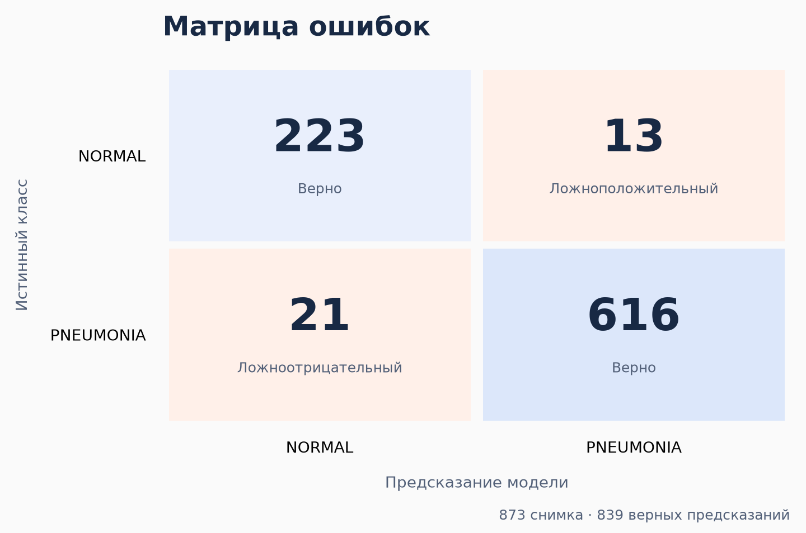
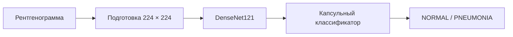

<div align="center">

# NIR
### Распознавание рентгеновских снимков грудной клетки

DenseNet121 + капсульная нейронная сеть · Python · PyTorch

[Результаты](#результаты) · [Запуск](#запуск) · [Как это работает](#как-это-работает)

</div>

---

Проект обучает модель различать два класса снимков: **NORMAL** и **PNEUMONIA**.
На вход поступает рентгенограмма, на выходе получается предсказание класса.
Для папки снимков результаты сохраняются в CSV.

Это готовая основа для экспериментов с медицинскими изображениями: можно
подготовить данные, обучить модель, измерить качество и обработать новые снимки.
Код сохраняет состав выборок, лучшие веса и ошибки по каждому изображению,
чтобы результат можно было проверить и разобрать.

## Результаты

На **873 отложенных снимках** модель правильно классифицировала **839**.
Получены следующие показатели:

| Показатель | Результат | Что он показывает |
| :--- | ---: | :--- |
| Accuracy | **96,11 %** | Доля правильно классифицированных снимков |
| Чувствительность | **96,70 %** | Доля найденных снимков класса PNEUMONIA |
| Специфичность | **94,49 %** | Доля правильно распознанных снимков NORMAL |
| F1 | **0,9731** | Баланс точности положительных предсказаний и полноты |
| ROC-AUC | **0,9902** | Способность разделять классы при разных порогах |
| Average precision | **0,9965** | Качество ранжирования по классу PNEUMONIA |



Модель допустила **13 ложноположительных** и **21 ложноотрицательный** результат.
Всего использовано 5 824 изображения после исключения 32 точных дубликатов:
4 078 для обучения, 873 для выбора модели и порога, 873 для итоговой оценки.
Обучение завершилось после 11 эпох; выбран checkpoint шестой эпохи.

Это результаты одного локального эксперимента. Группы сформированы по именам
файлов, а не по подтверждённым идентификаторам пациентов. Происхождение локальной
копии данных и её пересечение с данными предобучения не подтверждены.
Качество на снимках других учреждений не проверялось; модель не предназначена
для постановки медицинского диагноза.

## Запуск

Нужен **Python 3.12**. Снимки и обученные веса в репозиторий не входят:
после установки нужно предоставить данные и обучить модель.

### 1. Установить

```bash
git clone https://github.com/nico1008/NIR.git
cd NIR
python -m venv .venv
```

Активировать окружение:

| Система | Команда |
| :--- | :--- |
| Windows · PowerShell | `.\.venv\Scripts\Activate.ps1` |
| Linux / macOS | `source .venv/bin/activate` |

```bash
python -m pip install -e .
```

Для NVIDIA GPU установите подходящую версию PyTorch **до установки проекта**.
В проведённом эксперименте использовалась CUDA 12.8:

```bash
python -m pip install torch torchvision --index-url https://download.pytorch.org/whl/cu128
python -m pip install -e .
```

Другие варианты установки доступны на [сайте PyTorch](https://pytorch.org/get-started/locally/).
Без CUDA код использует CPU; обучение будет медленнее.

### 2. Подготовить снимки

```text
data/
├── NORMAL/
│   └── IM-0001-0001.jpeg
└── PNEUMONIA/
    └── person1_bacteria_1.jpeg
```

Поддерживаются JPG, JPEG и PNG. Названия папок задают классы.
Имена снимков должны содержать идентификаторы вида `IM-0001`, `NORMAL2-IM-0001`
или `person1`: по ним изображения объединяются в группы перед разделением.
Для файлов с другими именами потребуется адаптировать правило группировки
в [`data.py`](src/nir/data.py).

Можно использовать вложенные папки. Команда `audit` объединяет все найденные
снимки и создаёт новое разделение; исходные папки `train` и `test` его не задают.

### 3. Обучить и оценить

```bash
nir audit --data data --out runs/default
nir train --out runs/default
nir evaluate --out runs/default
```

- `audit` исключает дубликаты и фиксирует выборки примерно 70 / 15 / 15 %.
- `train` обучает модель и сохраняет лучшие веса.
- `evaluate` рассчитывает показатели на итоговой выборке.

При первом обучении загружаются предобученные веса TorchXRayVision.
Модель и порог выбираются по проверочной выборке. Итоговая оценка выполняется
один раз; повторный запуск и перезапись обученного эксперимента блокируются.
Для нового эксперимента укажите другую папку в `--out`.

### 4. Обработать новые снимки

```bash
nir predict --out runs/default --folder images
```

В `runs/default/folder_predictions.csv` появятся путь к снимку, две оценки
классов и предсказание: **0 = NORMAL**, **1 = PNEUMONIA**.
Оценки классов не являются вероятностями заболевания.

## Как это работает



**DenseNet121** извлекает признаки снимка. Используются веса TorchXRayVision,
предобученные на рентгенограммах грудной клетки. **Капсульный классификатор**
связывает признаки через три итерации динамической маршрутизации и формирует
оценки двух классов.

Первые три эпохи обучается капсульная часть, затем подключается последний блок
DenseNet. Замороженные слои сохраняют свои параметры и статистику нормализации.
Используются AdamW и функция потерь с учётом дисбаланса классов.
Параметры собраны в [`config.py`](src/nir/config.py).

Обработка одинакова при обучении и предсказании: один канал, центральная обрезка
и размер 224 × 224. Обрезка может исключать периферические участки снимка.
Преимущество капсул перед другими классификаторами в этом эксперименте не проверялось.

## Что сохраняется

Все результаты остаются в папке, указанной через `--out`.

| Файл | Для чего нужен |
| :--- | :--- |
| `best.pt` | Лучшие веса модели |
| `test_metrics.json` | Показатели качества и матрица ошибок |
| `test_predictions.csv` | Предсказания на итоговой выборке и отметки ошибок |
| `folder_predictions.csv` | Результаты обработки новых снимков |
| `manifest.csv` | Состав выборок, группы и контрольные суммы изображений |
| `config.json`, `history.json` | Условия и ход обучения |
| `threshold.json` | Порог классификации, выбранный на проверочной выборке |

## Навигация по коду

| Файл | Содержание |
| :--- | :--- |
| [`model.py`](src/nir/model.py) | DenseNet, капсулы и функция потерь |
| [`data.py`](src/nir/data.py) | Проверка данных, разделение и обработка снимков |
| [`engine.py`](src/nir/engine.py) | Обучение, оценка и предсказания |
| [`cli.py`](src/nir/cli.py) | Четыре команды запуска |
| [`config.py`](src/nir/config.py) | Параметры эксперимента |
| [`tests/`](tests) | Проверки модели, данных и сохранения результатов |

<details>
<summary>Проверка кода и точное окружение эксперимента</summary>

```bash
python -m pip install -e ".[test]"
pytest
```

15 тестов проверяют градиенты, замороженные слои, разделение групп,
обработку изображений, сохранение предсказаний и полный цикл работы
на синтетических данных. Для тестов не нужны снимки или GPU.

Точные версии библиотек исходного эксперимента сохранены в
[`requirements/experiment-cu128.txt`](requirements/experiment-cu128.txt).
Для восстановления окружения Windows / Python 3.12:

```bash
python -m pip install -r requirements/experiment-cu128.txt --extra-index-url https://download.pytorch.org/whl/cu128
python -m pip install -e . --no-deps
```

Все команды также доступны через `python -m nir`.
Параметр `--workers 0` отключает фоновые процессы загрузки данных.

</details>

## Основа проекта

[TorchXRayVision](https://github.com/mlmed/torchxrayvision) ·
[Описание библиотеки](https://arxiv.org/abs/2111.00595) ·
[Dynamic Routing Between Capsules](https://papers.nips.cc/paper/2017/hash/2cad8fa47bbef282badbb8de5374b894-Abstract.html)
